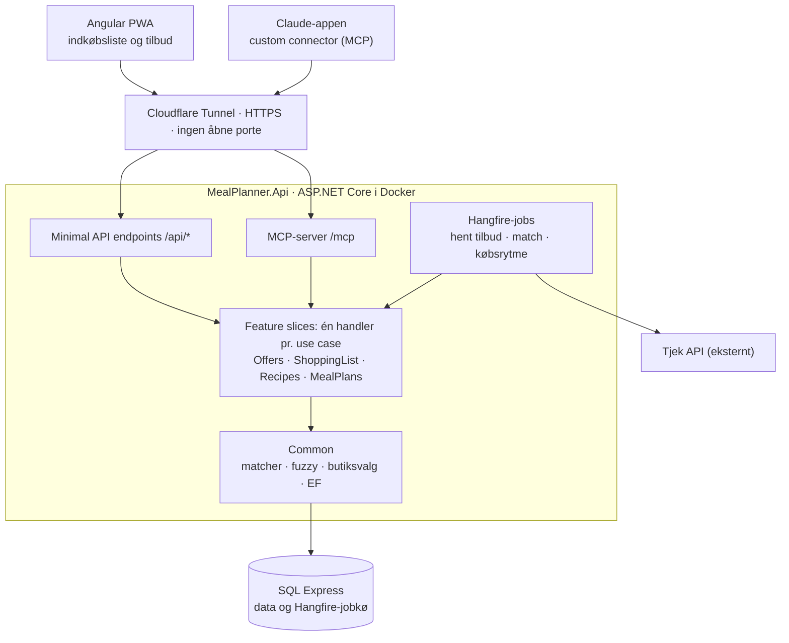

# MealPlanner – kravspecifikation

Version 6. november 2026 · Marc Creutzberg
Kilde: kravspecifikationen i Claude (Docs) plus fund fra prototype og afprøvning med rigtige tilbud 31/10–6/11 2026.

> **Til Claude Code:** Læs hele filen før du koder. Al kode, navne, kommentarer og commit-beskeder skrives på **engelsk**; kun brugerfladetekster og data (kategorier, råvarer, butiksnavne) er på dansk. Følg faseplanen i afsnit 11 og byg én fase ad gangen. Afsnit 12 indeholder konkrete fund om Tjek-API'et og tilbudsdata, som er verificeret mod live data.

---

## 1. Formål og mål

MealPlanner gør ugens indkøb og aftensmad billigere og nemmere: én fælles indkøbsliste, der kender ugens tilbud fra REMA 1000, Netto, Kvickly, Løvbjerg, Lidl og Coop 365, og som Claude kan arbejde med via MCP.

Brugere i v1 er Marc og Pia i én husstand i Odder. Appen hostes på Marcs NUC (Windows + Docker) og er samtidig et lærings- og udfordringsprojekt i forhold til den stak, vi normalt bruger på arbejdet.

Succeskriterier for v1:

- Ugens indkøbsliste laves i appen i stedet for i Coop-appen.
- Hver vare på listen viser automatisk, om den er på tilbud, og i hvilken butik.
- Claude kan foreslå en uges aftensmad ud fra tilbuddene og lægge varerne på listen.
- En indkøbstur følger reglen: REMA først, plus én eller to andre butikker, når det kan betale sig.

## 2. Scope

V1 dækker fire områder: tilbud, indkøbsliste, opskrifter med madplan og MCP. Alt andet er bevidst udskudt, men datamodellen forberedes, så det kan komme senere uden migrering.

| Område | V1 | Senere |
| --- | --- | --- |
| Brugere | Marc og Pia, én husstand | Flere husstande med invitationer |
| Butikker | Fælles opsætning: Odder, 20 km, seks kæder, REMA som hjemmebutik | Placering, kæder og hjemmebutik pr. husstand |
| Opskrifter | Genereres af Claude via MCP | Import fra URL (schema.org/Recipe), manuel indtastning, deling mellem husstande |
| Frontend | Indkøbsliste, indkøbstur og tilbud som Angular PWA | Madplan og opskrifter i Angular (indtil da via Claude) |
| Priser | Tilbudspriser, førpriser og Lidls faste lave priser fra Tjek | Egen normalprisliste til præcis beregning af besparelse |
| Adgang | Cloudflare Tunnel | Ingen ændring |

## 3. Tilbud

Tilbud hentes dagligt fra Tjeks offentlige (uofficielle) API og kobles til råvarer, så resten af appen kan spørge "er kyllingebryst på tilbud, og hvor?".

1. **Hentning:** et Hangfire-job henter alle tilbud for de valgte kæder inden for husstandens radius hver dag kl. 06, plus ekstra torsdag–søndag morgen, hvor de nye aviser starter (se 12.3). Kommende tilbud med senere startdato gemmes også.
2. **Opdatering:** tilbud identificeres på Tjeks offer-id. Eksisterende opdateres, udløbne slettes efter 30 dage.
3. **Matching:** hvert tilbud kobles til en eller flere råvarer via råvarens søgeord og udelukkelsesord, fx "kyllingebryst" men ikke "pålæg". Ét tilbud kan dække flere råvarer ("flæsk i skiver eller koteletter"). Fejlramte tilbud forbliver uden råvare.
4. **Manuel mapping:** tilbud uden råvare kan mappes manuelt i appen eller af Claude. En mapping gemmes som nyt søgeord, så træfprocenten stiger, og manuelle mappinger overskrives aldrig af jobbet.
5. **Søgning:** fritekst med fuzzy match på tilbudstekst og råvare, filter på kæde og gyldighed (i dag, denne uge, kommende).
6. **Faste lave priser:** tilbud med meget lang gyldighed (fx Lidl "Fast lav pris", 3/5–31/12) markeres som hverdagspris, ikke kampagne, og bruges som normalpris for den vare.

Acceptkriterie: mindst 80 % af kød-, fisk- og grøntsagstilbud har en råvare efter fire ugers brug.

## 4. Indkøbsliste

Indkøbslisten er v1's vigtigste skærm. Den følger opbygningen fra Coop-appen og tilføjer tilbud på tværs af kæder, bedre søgning og faste varer.

**Grundfunktioner (som Coop-appen)**

- Varer grupperet i farvede kategorier, sorteret i REMA's gangrækkefølge: Frugt og grønt, Brød, Kød/fisk/fjerkræ, Pålæg, Mejeri, Kolonial, Frost, Drikkevarer, Slik og snacks, Husholdning, Personlig pleje, Andet.
- Navn, mængde og flueben pr. vare. "Skjul indkøbte varer" og en stor plus-knap.
- Én aktiv fælles liste pr. husstand. Ændringer vises hos den anden i realtid (SignalR).

**Automatisk kategori**

1. Startordbog med ca. 300–500 almindelige dagligvarer og deres kategori.
2. Råvaretabellen genbruges: en vare, der matcher en råvare, får råvarens kategori.
3. Flytter en bruger en vare til en anden kategori, gemmes det som en lært regel.
4. Ukendte ord klassificeres én gang af Claude (Haiku) og caches som regel.

**Fuzzy søgning ved indtastning**

- Normalisering: små bogstaver, ae/oe/aa = æ/ø/å, mellemrum og bindestreger ignoreres.
- Præfiks-match mens man skriver, stavefejl via Damerau-Levenshtein (1 fejl i korte ord, 2 i lange), bøjninger og synonymer.
- Rangering: præcist match, så præfiks, så fuzzy, og ved lighed det husstanden køber oftest.
- Valgte rettelser gemmes som alias ("hyteost" giver hytteost).
- Ordforrådet er lille (få tusinde navne), så søgningen kører in-memory i .NET, ikke i SQL.

**Faste varer ("Plejer I at købe?")**

- Hver vare, der markeres som købt, gemmes i købshistorikken.
- Appen beregner rytmen pr. vare (gennemsnitlige dage mellem køb) og foreslår varer, når ca. 80 % af intervallet er gået, med sidste mængde som standard.
- Varer kan fastgøres som "altid med". Et forslag kan swipes væk som "har nok" uden at påvirke rytmen.
- Forslag, der er på tilbud, viser et tilbudsbadge.

**Tilbud og butiksplan**

- Hver vare med et tilbud viser et badge: butik, pris og sidste gyldighedsdag.
- Butiksplan: REMA er altid med. Den butik, der sparer mest på listens varer, bliver nr. 2. En butik nr. 3 kommer kun med, hvis den sparer mere end en grænse (standard 50 kr.).
- **Butiksgrupper:** butikker, der ligger samme sted, tæller som ét stop. I Odder ligger Lidl og Coop 365 ved siden af hinanden, så de kan tages med sammen uden at tælle som to ekstra butikker.
- Listen kan vises samlet eller som én fane pr. butik i planen.
- Varer kan lægges på listen direkte fra tilbudsvisningen og fra madplanen.

**Butiksflag: hvor en vare skal købes**

- En vare på listen kan flages til en bestemt butik, fx "kakao → Kvickly". Flaget vinder altid over butiksplanen.
- Flaget kan sættes manuelt eller automatisk, når varen lægges på listen fra et tilbud. Et tilbudsflag viser også sidste gyldighedsdag.
- Faste butiksvalg pr. vare: "bleer køber vi altid i Netto". Gemmes på husstanden og sættes automatisk, hver gang varen kommer på listen.
- En butik, der kun er med på grund af et flag, kommer med i butiksplanen, også selv om besparelsen er under grænsen for butik nr. 3.
- Listen kan filtreres på butik.

**Varespecifikation**

- En vare kan have et præciserende mærke eller en variant, fx "Havarti → Castello" eller "Smør → rigtigt smør, ikke smørbar". Matcheren skal respektere det, så Kærgården ikke foreslås, når der står "rigtigt smør", og "hamburgerryg (pålæg)" ikke matcher en hel røget hamburgerryg pr. ½ kg.

**Indkøbstur: listen delt op efter butik**

Fra indkøbslisten trykker man "Find tilbud". Appen laver en indkøbstur ud fra butiksplanen og viser den som en enkel tjekliste (se eksempel i 12.6):

- Én overskrift pr. butik, i den rækkefølge turen køres, fx Lidl, Coop 365 og så REMA.
- Under hver butik står varerne som afkrydsningsliste med navn og mængde. Kendt pris står diskret til sidst, fx "Smør (Milbona), 5 stk. · 9,95". Subtotal pr. butik for de kendte priser.
- Underoverskrifter samler varer fra samme ret eller anledning, fx "Bagning" eller "Fødselsdag og resten". De kommer fra opskriften eller et tag på varen.
- Varer uden tilbud nogen steder ligger i hjemmebutikken.
- Varer med et butiksflag ligger altid i den butik, de er flaget til.
- Turen kan deles som ren tekst til Noter eller en besked, med samme opbygning.
- Afkrydsning i turen markerer varen som købt på indkøbslisten og gemmer butikken i købshistorikken.

## 5. Opskrifter og madplan

I v1 skaber Claude opskrifterne, og backenden husker dem og scorer dem mod tilbuddene. Der bygges ingen opskriftsredigering i Angular i v1.

1. **Opret via Claude:** Claude gemmer en ret med navn, portioner, tid, børnevenlig ja/nej, ingredienser (tekst og mængde) og hvilke der er hovedingredienser. Fremgangsmåden gemmes som kort tekst.
2. **Kobling til råvarer:** hver ingrediens matches til en råvare med samme matcher som tilbud. Ingredienser uden match gemmes som tekst.
3. **Retforslag:** en ret scores efter andelen af hovedingredienser, der er på tilbud i perioden. Ved lighed vinder den billigste, og retter med tilbud i hjemmebutikken vægtes lidt højere. Filter: børnevenlig, maks. tid, ikke spist de sidste 14 dage.
4. **Madplan:** en uge (mandag til søndag) med én ret pr. dag. Gemmes via Claude og kan læses i appen.
5. **Fra madplan til liste:** madplanens ingredienser lægges på indkøbslisten med ét kald, slået sammen med varer, der allerede står der, og mængder lagt sammen på tværs af opskrifter (fx smør 600 g + 250 g + 175 g = ca. 1 kg).

Acceptkriterie: "giv mig fem børnevenlige retter ud fra ugens tilbud" i Claude giver forslag, hvor hver ret viser butik og tilbudspris for sine hovedingredienser.

## 6. MCP-tools

MCP-serveren ligger i API'et på `/mcp` (HTTP-transport). Hvert tool kalder den samme handler som det tilsvarende HTTP-endpoint, så logikken findes kun ét sted.

| Tool | Input | Output |
| --- | --- | --- |
| `search_offers` | tekst, kæde (valgfri), periode | tilbud med kæde, pris, førpris, gyldighed, råvare |
| `suggest_meals` | antal, børnevenlig, maks. tid | retter med score, tilbud pr. hovedingrediens, samlet tilbudspris |
| `add_recipe` | navn, portioner, tid, børnevenlig, ingredienser (tekst, mængde, hoved), fremgangsmåde | opskrift med koblede råvarer og umatchede ingredienser |
| `save_meal_plan` | uge, dag → ret | gemt madplan |
| `get_shopping_list` | — | listen grupperet på kategori med tilbudsbadges |
| `add_to_shopping_list` | varer (navn, mængde, butik valgfri, tag valgfri) | tilføjede varer med kategori og tilbud |
| `build_shopping_list` | madplan (valgfri), ekstra varer | butiksplan/indkøbstur: REMA + 1–2 butikker, varer pr. butik, kendte priser, anslået besparelse |
| `map_offer` | tilbud-id, råvare | opdateret tilbud, nyt søgeord gemt |

Alle tools er afgrænset til brugerens husstand.

## 7. Arkitektur og teknik

Vertical Slice Architecture: koden organiseres efter use case, og hver handler kaldes fra både et Minimal API-endpoint og et MCP-tool.



| Del | Valg |
| --- | --- |
| Runtime | .NET 10, ASP.NET Core Minimal APIs |
| Orkestrering | .NET Aspire lokalt, genereret docker-compose til NUC'en |
| Data | EF Core mod SQL Express (container, `MSSQL_PID=Express`) |
| Baggrundsjobs | Hangfire med SQL Server-storage i samme database |
| MCP | `ModelContextProtocol.AspNetCore`, HTTP-transport på `/mcp` |
| Frontend | Angular PWA, danske tekster i i18n-filer |
| Realtid | SignalR til den fælles indkøbsliste |
| Fejlhåndtering | Result pattern for forventede fejl, endpoint-filtre til validering og logging |
| Bevidst fravalgt | Wolverine (for meget nyt på én gang), MediatR (ikke nødvendigt med slices) |

Pakkeversioner, der blev brugt i prototypen (okt./nov. 2026): Aspire 13.6.4, EF Core 10.0.14, Hangfire 1.8.25, ModelContextProtocol.AspNetCore 2.3.0.

**Mappestruktur**

```
src/
  MealPlanner.AppHost/          Aspire orchestration
  MealPlanner.ServiceDefaults/  OpenTelemetry, health checks
  MealPlanner.Api/
    Domain/                     Entities with behaviour
    Common/
      Data/                     AppDbContext, SeedData, migrations
      Tjek/                     TjekClient (the only class that knows the Tjek API)
      Matching/                 IngredientMatcher
      Search/                   FuzzySearch
      Stores/                   StoreSelector (trip planning)
      Meals/                    MealScorer
      Categories/               CategoryClassifier
    Features/
      Offers/        SearchOffers.cs, FetchOffersJob.cs, MapOffer.cs
      ShoppingList/  AddItem.cs, GetList.cs, BuildTrip.cs, MarkBought.cs
      Recipes/       AddRecipe.cs, SuggestMeals.cs
      MealPlans/     SaveMealPlan.cs
    Mcp/                        Tool classes that call the slice handlers
web/                            Angular PWA
```

**Regler for genbrug på tværs af slices**

- Domænelogik bor i entiteterne, fx `Offer.IsValidOn()` og `ShoppingListItem.MarkBought()`.
- Ægte delt logik ligger i små klasser under `Common/`: `IngredientMatcher`, `FuzzySearch`, `StoreSelector`, `MealScorer`.
- Slices kalder aldrig hinandens handlers. Har to slices brug for samme logik, flyttes den til `Common/`.
- Kode, der bare ligner, må gerne være duplikeret.
- Al kode, navne og kommentarer skrives på engelsk. Kun brugerfladetekster og data er på dansk.

## 8. Datamodel

Alle husstandsdata bærer `HouseholdId` fra dag ét. Råvarer, kategorier, butikker og tilbud er fælles referencedata, mens husstandens egne regler og aliaser ligger i egne tabeller.

| Tabel | Nøglefelter | Ejer |
| --- | --- | --- |
| `Household` | navn, placering (lat/lng), radius, grænse for butik nr. 3 | — |
| `User` (ASP.NET Identity) | e-mail, visningsnavn, `HouseholdId` | Husstand |
| `ApiKey` | bruger, hash, navn, oprettet, tilbagekaldt | Husstand |
| `Store` | navn, Tjek-dealer-id, farve | Fælles |
| `HouseholdStore` | butik, er hjemmebutik, aktiv, butiksgruppe (samme stop) | Husstand |
| `Category` | navn, farve, sortering | Fælles |
| `CategoryRule` | ord, kategori, lært ja/nej | Fælles + husstand |
| `Ingredient` / `IngredientAlias` | navn, kategori / søgeord, udelukkelse | Fælles + husstand |
| `Offer` | Tjek-id, butik, overskrift, beskrivelse, pris, førpris, gyldig fra/til, er fast lav pris, kræver app/medlemskab, maks. pr. kunde, manuelt mappet | Fælles |
| `OfferIngredient` | tilbud, råvare (mange-til-mange) | Fælles |
| `Recipe` / `RecipeIngredient` | navn, portioner, tid, børnevenlig, fremgangsmåde / tekst, mængde, råvare, hoved | Husstand |
| `MealPlan` / `MealPlanEntry` | uge / dato, ret | Husstand |
| `ShoppingList` / `ShoppingListItem` | navn / vare, mængde, variant/mærke, tag, kategori, råvare, planlagt butik, butiksflag, flagkilde (manuel, tilbud, fast valg), tilbud, købt, tilføjet af | Husstand |
| `ItemStorePreference` | vare, butik | Husstand |
| `PurchaseHistory` | vare, mængde, butik, pris, købt | Husstand |
| `PinnedItem` | vare, standardmængde | Husstand |

Det fælles/husstand-skel betyder, at en ny husstand i en anden by kun kræver nye `Household`- og `HouseholdStore`-rækker.

## 9. Sikkerhed og drift

Alt kører på NUC'en i Docker. Den eneste vej ind udefra er en Cloudflare Tunnel, så der åbnes ingen porte i routeren.

- **Login:** ASP.NET Identity med to brugere i v1 og cookie-login til Angular. Ingen åben registrering; brugere oprettes af Marc. Clerk er fravalgt (kan ikke selvhostes).
- **MCP-login:** en API-nøgle pr. bruger i headeren `X-Api-Key`, som Claude-connectoren sender på hvert kald (felt "Request headers" i custom connector). Nøglen gemmes kun som hash og er koblet til bruger og husstand. Nøgler oprettes og tilbagekaldes af Marc. Cloudflare tillader kun Anthropics IP-adresser på `/mcp`. Connectoren oprettes på private Claude-konti, ikke Team-kontoen, hvor alle medlemmer deler én header-nøgle. **Fallback**, hvis header-feltet ikke findes på kontoen: hemmelig sti `/mcp/<lang tilfældig nøgle>` uden login, låst til Anthropics IP-adresser. OAuth (OpenIddict) kommer først med flere husstande.
- **Hangfire-dashboard:** kun for indloggede brugere og kun via WireGuard.
- **Hemmeligheder:** connection strings og nøgler i miljøvariabler eller user secrets, aldrig i Git.
- **Backup:** daglig SQL-backup med 14 dages historik, kopieret til Seafile.
- **Overvågning:** Aspire-dashboard lokalt. Mislykkede jobs synlige i Hangfire. Fejlede Tjek-hentninger logges med antal tilbud pr. kæde, så et ændret API opdages samme dag.
- **Opdatering:** docker-compose genereret af Aspire. Ny version = pull, build, `docker compose up -d`. EF-migrationer køres ved opstart.

## 10. Åbne punkter og risici

| Emne | Risiko | Forslag |
| --- | --- | --- |
| MCP-login med flere husstande | API-nøgler i headers er fine til to brugere, men ikke til selvbetjening | Afgjort for v1: API-nøgle pr. bruger. Ved flere husstande: OpenIddict oven på Identity og "Use your own OAuth client" i connectoren |
| Tjek-API'et er uofficielt | Kan ændre sig eller lukke uden varsel | Hentningen isoleres i `TjekClient`, fejl logges pr. kæde, appen virker uden tilbud |
| Normalpriser mangler | Besparelse for butik nr. 2 og 3 er et skøn | Lidls "fast lav pris"-varer giver rigtige hverdagspriser. Ellers førpris, når den findes, ellers en fast procent. Senere egen prisliste og købshistorikkens priser |
| Matchningskvalitet | Fritekst-tilbud rammes forkert (se 12.4) | Mange-til-mange mellem tilbud og råvare. Manuel mapping skal være hurtig |
| Opskrifters ophavsret | Kopierede fremgangsmåder fra madsider | Claude-genererede opskrifter i v1. Ved URL-import senere gemmes kun ingredienser og link |

## 11. Faseplan

Hver fase slutter med noget, der kan bruges på NUC'en. Indkøbslisten kommer før madplanen, fordi den bruges hver uge fra dag ét.

1. **Fundament:** solution med Aspire, API, EF Core, SQL Express, Hangfire, seed-data og login for to brugere. Deploy til NUC'en via Cloudflare Tunnel.
2. **Tilbud og MCP:** Tjek-hentning, matching, søgning og manuel mapping. MCP på `/mcp` med API-nøgler og tools til tilbud, så det kan bruges fra Claude med det samme.
3. **Indkøbsliste og indkøbstur:** Angular PWA med kategorier, fuzzy søgning, tilbudsbadges, butiksflag, realtid, butiksplan og indkøbstur, plus MCP-tools til listen.
4. **Opskrifter og madplan:** `add_recipe`, `suggest_meals`, `save_meal_plan` og madplan til indkøbsliste.
5. **Faste varer:** købshistorik, rytmeforslag og fastgjorte varer. Kommer efter nogle ugers brug, så der er historik.

- [x] Beslut MCP-login: API-nøgle pr. bruger i v1
- [ ] Lav startordbog med 300–500 varer til fase 3
- [ ] Tjek om "Request headers" findes på de private Claude-konti (ellers fallback, afsnit 9)

---

## 12. Fund fra prototype og afprøvning (verificeret mod live data)

### 12.1 Tjek-API'et

Tjek (tidligere eTilbudsavis/ShopGun) leverer data til eTilbudsavis-appen. API'et er offentligt men udokumenteret; ingen nøgle, login, proxy eller browser er nødvendig.

```
GET https://squid-api.tjek.com/v2/dealers?country_id=DK&limit=100&offset=0
GET https://squid-api.tjek.com/v2/offers?dealer_ids=<id>&r_lat=55.9727&r_lng=10.1526&r_radius=20000&limit=100&offset=<n>
```

- Paginering: `limit` maks. 100. Hent med stigende `offset`, indtil et svar har færre end 100 elementer.
- Én kæde giver typisk 150–600 tilbud inden for 20 km af Odder (Kvickly ~495, Lidl ~600, Netto ~490, REMA ~250, Løvbjerg ~180, Coop 365 ~150). Svaret indeholder både den aktuelle og den næste avis.
- Relevante felter pr. tilbud: `id`, `heading`, `description`, `pricing.price`, `pricing.pre_price` (ofte `null`), `quantity` (unit/size/pieces), `run_from`, `run_till` (UTC, fx `2026-10-30T23:00:00+0000` = dansk midnat), `dealer.id`, `dealer.name`, `catalog_page`, `images.view`.
- Tidszone: konvertér `run_from`/`run_till` til Europe/Copenhagen før visning og gyldighedstjek.
- Dubletter: samme vare kan optræde flere gange (fx i både avis og "spot"). Dedupliker på (kæde, normaliseret overskrift, pris, run_from).
- Felter som EAN, brand og kategori findes ikke. Overskriften er fritekst.

### 12.2 Kæder og Tjek-dealer-id'er

| Kæde | Tjek dealer-id | Bemærkning |
| --- | --- | --- |
| REMA 1000 | `11deC` | Hjemmebutik |
| Netto | `9ba51` | Nogle priser kræver Netto+ appen |
| Kvickly | `c1edq` | Medlemspris står i beskrivelsen |
| Løvbjerg | `65caN` | Overskrifter kan indeholde emojis |
| Lidl | `71c90` | Har "Fast lav pris" med gyldighed 3/5–31/12 = hverdagspris |
| Coop 365 | `DWZE1w` | Hedder "365discount" i Tjek. Ligger ved siden af Lidl i Odder |

### 12.3 Avisskift (observeret november 2026)

| Kæde | Avis gælder |
| --- | --- |
| REMA 1000 | søndag–lørdag (fx 8/11–14/11), plus korte torsdag–lørdag-tilbud |
| Netto | lørdag–fredag (fx 7/11–13/11) |
| Kvickly | fredag–torsdag (fx 6/11–12/11), plus månedstilbud |
| Løvbjerg | fredag–torsdag, plus "kun i dag"-tilbud |
| Lidl | søndag–lørdag plus torsdag–lørdag-tilbud og "fast lav pris" |
| Coop 365 | torsdag–onsdag (fx 5/11–11/11) |

Konsekvens: en indkøbstur på en fredag skal vise, at REMA og Netto skifter inden for 1–2 dage, og hvilke tilbud der kun gælder i dag ("kun i dag", fx bland selv-slik).

### 12.4 Matching-fund

- I prototypen (Excel-beta) blev 132 af 1.136 tilbud (ca. 12 %) mappet med 37 råvarer. De fleste umappede tilbud er non-food, vin, slik og julevarer, som ikke skal mappes.
- Overskrifter dækker ofte flere varer: "Dansk kyllingebrystfilet, -inderfilet eller -lårfilet", "Netto dansk flæsk i skiver eller koteletter", "Herregårds-rødkål, Meny chips el. Kims franske kartofler". Kræver mange-til-mange og split på "eller"/"el.".
- Udelukkelsesord er nødvendige: kyllingebryst ≠ "kyllingebrystfilet pålæg", kartofler ≠ "flødekartofler"/"kartofler på glas"/"chips", mælk ≠ "kokosmælk"/"chokolademælk", smør ≠ "smørbar"/"Kærgården" når der kræves rigtigt smør, laks ≠ "røget laks", fløde ≠ "flødeboller"/"flødeis", hamburgerryg (pålæg) ≠ hel røget hamburgerryg pr. ½ kg.
- Brand-ord peger på kategorien: "Cocio", "Matilde", "Blue Keld" = kakaomælk; "Lurpak", "Milbona", "Deluxe" = smør; "Castello" = ost.
- Kød sælges ofte "pr. ½ kg" (pris for en halv kg). Normalisér til kg-pris før sammenligning.
- Mængdeinterval i overskrift/beskrivelse: "400-1000 g", "Kg-pris maks. 122,50". Gem "maks."-kg-pris, når den findes.
- Beskrivelsen indeholder vigtige betingelser, der skal udtrækkes: "Gælder kun med Netto+ appen", "Maks. 3 stk. pr. kunde", "Medlemspris", "Begrænset parti", "Gælder KUN fredag d. 6 november", "Sælges først kl. 20.59".

### 12.5 Brugeradfærd (fra afprøvningen)

- Strategien er: start i REMA, tag én butik mere med de bedste tilbud, og tag en tredje med, hvis der er rigtig gode tilbud.
- Når to butikker ligger samme sted (Lidl + Coop 365 i Odder), tæller de som ét stop.
- Indkøbslisten kommer i dag som screenshot fra Coop-appen; opskrifter som screenshot fra madsider (fx kagerecepter). Claude skal kunne læse begge og lægge varerne på listen med samlede mængder.
- Brugerne præciserer varer efterfølgende ("det er rigtigt smør", "havarti er Castello", "hamburgerryg er pålæg"). Det skal være nemt at rette en vare og få tilbuddene genberegnet.
- Ønsket visning af indkøbsturen er den enkle tjekliste i 12.6, som også fungerer i iOS Noter.

### 12.6 Eksempel på indkøbstur (fredag 6/11 2026, fødselsdag og to kager)

Bruges som acceptkriterie for `build_shopping_list` og indkøbsturen.

```
Lidl (ca. 81 kr.)
- [ ] Smør (Milbona), 5 stk. · 9,95 kr. stk. = 49,75 kr.
- [ ] Sukker, 1 kg · 7,50 kr.
- [ ] Hvedemel, 2 kg · 9,95 kr.
- [ ] Hamburgerryg (pålæg, Pålægsslagteren) · 13,95 kr.

Coop 365 (ca. 47 kr.)
- [ ] Juice til børn: Capri-Sun 10-pak · 25 kr.
- [ ] Fanta 1,5 l · 10 kr.
- [ ] Mælk (Änglamark) · 12 kr.
- [ ] Lurpak, 3 stk. (valgfrit) · 12 kr. stk. = 36 kr.

REMA (ca. 164 kr. for tilbudsvarerne)
Bagning
- [ ] Æg, 2 bakker · 18 kr. stk. = 36 kr.
- [ ] Marcipan (Odense) · 29 kr.
- [ ] Kærnemælk, 1 l
- [ ] Flormelis, 1 kg
- [ ] Kakao
- [ ] Kanel, 30 g
- [ ] Citroner, 3 stk. (1 økologisk)
- [ ] Blå birkes
- [ ] Natron, bagepulver og vaniljesukker, hvis I mangler
Fødselsdag og resten
- [ ] Castello havarti · 25 kr.
- [ ] Fløde (piskefløde ½ l) · 10 kr.
- [ ] Faxe Kondi 1,5 l · 10 kr.
- [ ] Pepsi Max 1,5 l · 10 kr.
- [ ] Pålægschokolade · 29 kr.
- [ ] Deo til Pia (Nivea) · 15 kr.
- [ ] Spegepølse
- [ ] Ost
- [ ] Natbleer
```

### 12.7 MCP-connector i Claude

- Custom connectors (claude.ai, Desktop) kalder fra Anthropics cloud, så serveren skal kunne nås fra internettet; bag VPN virker den ikke. Firewall kan begrænses til Anthropics IP-adresser.
- Godkendelse: OAuth, ingen login, eller faste credentials (API-nøgle/bearer token) under "Request headers", som sendes på hvert kald og gemmes krypteret. På Team/Enterprise deler alle medlemmer samme credential, og kun Owners kan tilføje connectoren.
- Kilde: https://support.claude.com/en/articles/11175166-get-started-with-custom-connectors-using-remote-mcp
- I Claude Code sættes headers direkte i MCP-konfigurationen.

### 12.8 Startdata

Seed-data (kategorier i REMA-gangrækkefølge, de seks kæder, ca. 45 råvarer med søgeord/udelukkelser og ca. 250 kategoriord) blev skrevet i prototypen i `Common/Data/SeedData.cs`. Genskab den ud fra afsnit 4, 12.2 og 12.4, og udvid til 300–500 varer i fase 3.
